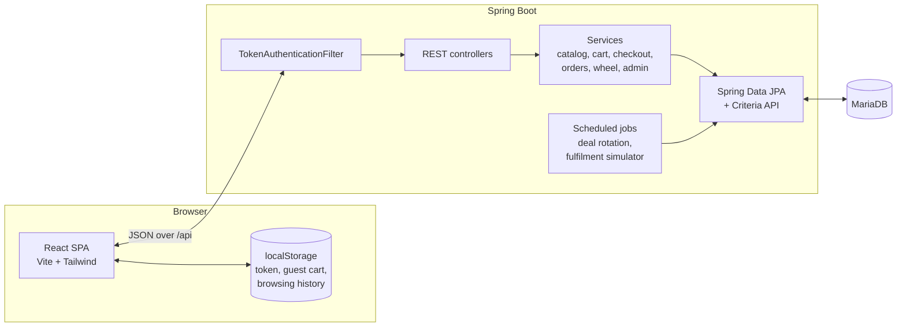
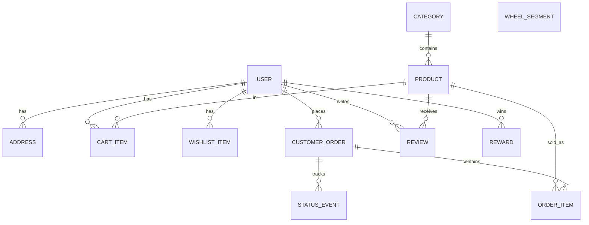

# e-commerce

**e-commerce** is a full-stack online marketplace inspired by Amazon and AliExpress, built as a showcase project. It covers the whole shopping journey, from browsing and search to the cart, checkout and order tracking, plus an admin dashboard for running the store. New customers get a server-side **Wheel of Fortune** spin that can win discounts, free delivery or a free item.

> Demo project: no real orders are fulfilled and no real payments are processed.

**Stack:** Java 21 · Spring Boot 4 · Spring Security · Spring Data JPA / Hibernate · MariaDB · React 19 · Vite · React Router · Tailwind CSS 4 · libphonenumber

---

## Contents

- [Feature overview](#feature-overview)
- [Architecture](#architecture)
- [How the features are built](#how-the-features-are-built)
- [API overview](#api-overview)
- [Data model](#data-model)
- [Getting started](#getting-started)
- [Project structure](#project-structure)
- [Possible improvements](#possible-improvements)
- [Credits](#credits)

---

## Feature overview

| Area | Highlights |
|---|---|
| **Storefront** | Home page with hero carousel, department tiles, Today's Deals with live countdowns, best sellers, top rated, new arrivals and browsing history |
| **Search** | Live suggestions, department selector, faceted filters (department, brand, price, rating, deals, stock), six sort orders, pagination, shareable URLs |
| **Product pages** | Image gallery with hover zoom, list vs. deal price, "About this item", specifications, delivery estimate, rating histogram, reviews with a *Verified Purchase* badge, related products |
| **Cart** | Guest cart merged into the account cart on sign-in, quantities, *Save for later*, free-delivery progress bar |
| **Checkout** | Address book, three delivery speeds with dates, wheel rewards, tax, live order total, simulated card payments with real validation |
| **Orders** | Order history with filters, order details, printable invoice, tracking timeline, cancel, return, *Buy it again* |
| **Accounts** | Registration with email verification codes, CAPTCHA-protected sign-up and sign-in, account hub, address book with international phone numbers, name/email/password management, Wish List, rewards |
| **Wheel of Fortune** | One spin per account after sign-up; prizes are drawn on the server with configurable odds |
| **Admin panel** | KPIs and a 14-day revenue chart, product management, order status management, customers, review moderation, wheel editor |

---

## Architecture



- **Backend:** a stateless REST API organised **by feature** (`catalog`, `cart`, `order`, `wheel`, …), not by layer. Each package holds its entity, repository, service, controller and DTOs. Entities are never serialised directly: every response is a Java `record` DTO mapped inside a transaction, so `spring.jpa.open-in-view` is disabled.
- **Frontend:** a React single-page app. Shared state (auth, cart, notifications) lives in React context, and server data is loaded through a small `useApi` hook. During development Vite proxies `/api` to the backend, so no CORS configuration is needed.
- **Deployment option:** the production build of the frontend can be served by Spring Boot itself as one deployable JAR. An SPA fallback (`WebConfig`) returns `index.html` for client-side routes such as `/dp/42`.

---

## How the features are built

### Authentication & security
- **Password storage:** BCrypt hashes via Spring Security's `PasswordEncoder`.
- **Tokens:** `TokenService` issues HMAC-SHA256 signed tokens in JWT format using only the JDK's `javax.crypto`, with no third-party JWT library. Signatures are compared in constant time (`MessageDigest.isEqual`) to avoid timing attacks. The signing secret comes from configuration. If none is set, a random key is generated at startup for local development.
- **Request authentication:** `TokenAuthenticationFilter` validates the `Authorization: Bearer` header and **reloads the user from the database on every request**, so role changes and deleted accounts take effect immediately. The filter is deliberately not a Spring bean, so it runs only inside the security chain and never twice.
- **Authorisation rules** (`SecurityConfig`): catalogue reads are public, cart/checkout/account endpoints require login, and `/api/admin/**` requires the `ADMIN` role. Sessions, CSRF, form login and HTTP Basic are disabled because the API is stateless.
- **Account enumeration protection:** login returns the same message for an unknown email and a wrong password, and the "resend code" endpoint answers the same way whether or not an account exists.

### Email verification
- **Flow:** sign-up creates an *unverified* account and emails a 6-digit code. Only `POST /api/auth/verify` with the correct code returns a login token, so unverified accounts cannot sign in (login answers `403` with the code `EMAIL_NOT_VERIFIED`, and the frontend redirects to the verification page with a fresh code).
- **Code security** (`EmailVerificationService`): codes come from `SecureRandom` and are stored only as BCrypt hashes. They expire after 10 minutes, allow 5 wrong guesses (failed attempts are committed even though the request fails, using `noRollbackFor`), and can be resent once every 60 seconds.
- **Abuse prevention:** the Wheel of Fortune opens only after verification, so free spins cannot be farmed with made-up email addresses.
- **Sending** (`EmailService`): HTML + plain-text emails over SMTP with Spring's `JavaMailSender`, for example through Gmail with an App Password. Spring Boot only creates the mail sender when `spring.mail.host` is configured; without it, emails are written to the application log, so the full flow can be tried locally with no mail account.
- **UI:** six single-digit inputs with auto-advance, backspace navigation, paste support and one-time-code autofill; the code submits itself when complete, and a resend link appears after the cooldown.
- Accounts that existed before verification was added are treated as verified (a column default), and the seeded demo accounts are created verified.

### CAPTCHA (Cloudflare Turnstile)
- Sign-up and sign-in are protected by **Cloudflare Turnstile**, a free CAPTCHA that usually passes without any puzzle.
- The widget (`Turnstile.jsx`) produces a single-use token that is sent with the form; `CaptchaVerifier` confirms it with Cloudflare's `siteverify` API using the secret key before any account logic runs. Calling the API directly without a valid token therefore fails.
- The site key is served by the backend (`GET /api/config`), so both keys are configured in one place. Cloudflare's public test keys are the defaults, so the project runs on localhost out of the box; real keys go in `application-local.properties`.

### Product catalogue & faceted search
- `ProductSearchService` builds queries with the **JPA Criteria API**, so every filter is optional and composable: keywords (each word must match title, brand, category or description), department, category, brands, price range, minimum rating, deals only and in stock.
- **Deal-aware prices in SQL:** price filters and price sorting use the *effective* price, computed with a SQL `CASE` expression that applies the discount only while a deal is active. Sorting by price therefore stays correct during sales.
- **Facets:** brand and department counts are calculated with `GROUP BY` queries for the current search. The brand facet ignores the brand filter itself, so shoppers can tick several brands.
- **Frontend:** every filter lives in the URL query string (`/s?department=electronics&brand=Apple&sort=PRICE_ASC`), so results are shareable, bookmarkable and survive a refresh.
- **Suggestions:** the search bar debounces input by 180 ms and fetches matching titles, with keyboard navigation through the suggestions.

### Pricing model & Today's Deals
- Each product has a regular `price`, an optional manufacturer `listPrice` and an optional time-limited deal (`dealPercent` + `dealEndsAt`). `Product.effectivePrice()` is the single source of truth for what the customer pays, and the struck-through reference price is derived from the same fields.
- `DealManager` runs **every hour** (`@Scheduled(cron)`): it clears expired deals and rotates new ones in at random, so the store always has about 30 live deals. The frontend shows live countdowns with a `Countdown` component.

### Product page & reviews
- The gallery uses CSS `transform-origin` following the cursor for a 2× hover zoom.
- The rating histogram comes from a `GROUP BY rating` query. The product's average rating and review count are **denormalised** onto the product and recalculated whenever a review is added or removed, so product lists never need to aggregate reviews.
- A review gets the **Verified Purchase** badge when the author has a non-cancelled order containing that product. Each customer can review a product once.
- Viewed product ids are stored in `localStorage`, and the home page resolves them in one batch request (`/api/products/by-ids`) for "Your browsing history".

### Cart
- **Guest cart:** shoppers can fill a cart without an account. It is kept in `localStorage` with the same data shape the server returns, so the cart page renders either one with the same code.
- **Merging:** on sign-in, `CartContext` posts the guest lines to `/api/cart/merge`. The server combines them with the saved account cart and clears the browser copy.
- Quantities are clamped to available stock and a per-line maximum, on both client and server. *Save for later* is a flag on the cart line, so items move between the two lists without being re-added.

### Checkout & payments
- **One pricing routine:** `CheckoutService.price()` is used both for the live summary (`POST /api/checkout/quote`) and when placing the order, so the customer is always charged exactly what they were shown. It covers subtotal, delivery (standard is free above $35), the reward discount, 8% tax and the total.
- **Delivery estimates** add business days and skip weekends. The same rule runs in Java and in JavaScript, so product pages and checkout show matching dates.
- **Placing an order is a single transaction:** stock is checked *before* the card is charged, then order lines are created with the price and title at purchase time, stock and sales counts are updated, the reward is marked as used and the cart is cleared. Any failure rolls the whole thing back.
- **`PaymentGateway`** simulates a card processor. It performs the checks a real one would (Luhn checksum, expiry date, CVC length per brand, brand detection) and supports test cards for success, decline and insufficient funds. Only the brand and last four digits are stored. Because it sits behind a single `charge()` method, a real provider such as Stripe could replace it without touching the checkout logic.

### Wheel of Fortune
- **Fair, server-side draw:** `WheelService.spin()` picks the outcome with a weighted random draw using `SecureRandom`, so P(segment) = weight / total weight. The browser only receives the result, which means the odds cannot be manipulated from the client.
- **One spin per account:** enforced by a `wheelSpun` flag on the user. A second attempt returns `409 Conflict`. Admins can grant another spin.
- **Rewards:** the prize becomes a `Reward` valid for 30 days. Percentage and free-item rewards apply to *one unit* of an item the customer picks at checkout; free delivery zeroes the shipping cost. Cancelling an order releases the reward so it can be used again.
- **Animation:** the wheel is an SVG drawn from the configured segments. After the server responds, the frontend calculates the rotation that brings the winning slice under the pointer (several full turns + offset + a small random jitter inside the slice) and animates it with a CSS transition, followed by a confetti effect.
- The wheel opens automatically once a new customer has verified their email, and is also available from *Your Rewards* while the spin is unused.

### Orders & tracking
- An order stores **snapshots** of the delivery address, item titles, images and prices, so later edits to products or the address book never change past orders. Order numbers are human-friendly (`EC-261102-482913`) and checked for uniqueness.
- Every status change is appended to a status history, which powers the tracking timeline.
- `OrderFulfilmentSimulator` stands in for a warehouse/carrier integration. Every minute it moves orders along Placed → Processing → Shipped → Out for delivery → Delivered, so tracking can be seen working in a demo. It can be turned off with `app.fulfilment.simulate=false`.
- Customers can cancel before shipping, which restocks items and returns any reward, and request returns after delivery. *Buy it again* re-adds items to the cart.

### Admin panel
- **Dashboard:** revenue, order count, customer count and average order value come from aggregate queries. The 14-day revenue series includes empty days so the bar chart (plain SVG, no chart library) has no gaps. Cancelled and returned orders are excluded from revenue.
- **Products:** create/edit with deal scheduling, images, highlights and stock. Products are **archived rather than deleted**, so existing orders keep valid references.
- **Orders, customers, reviews:** search and filter orders, change status, change roles (admins cannot remove their own admin access), grant extra wheel spins and moderate reviews. Deleting a review recalculates the product rating.
- **Wheel editor:** edit labels, prize types, values, weights and colours with a live wheel preview and computed win probabilities. Changes are validated server-side.

### Frontend design system
- Tailwind CSS 4 with design tokens in `@theme` (a dark "ink" navigation colour, teal for actions, amber for highlights) and a small set of reusable component classes (`btn-primary`, `card`, `input`, …) declared with `@utility`.
- Responsive from phone to wide desktop: filters move to a slide-out panel and the header compacts on small screens.
- Accessibility basics: semantic landmarks, a skip link, labelled form controls, `aria-*` on menus, dialogs and pagination, and keyboard support for search suggestions and modals.

### Demo data
- On first start, `DataSeeder` loads 194 products with images, specifications and reviews from the MIT-licensed DummyJSON dataset, grouped into 24 categories across 7 departments. It also creates the demo accounts and the default wheel. A fixed random seed gives every fresh install the same best sellers.
- Seeding is idempotent: each part is created only if it is missing, so restarts never duplicate data.

### International addresses & phone numbers
- **Every country:** the country list comes from libphonenumber's 245 supported regions, with English names from the browser's `Intl.DisplayNames` API, so no country list is maintained by hand. The default is guessed from the browser language (`sr-RS` → Serbia).
- **Phone input** (`PhoneInput.jsx`): a searchable flag + dialling-code picker sits next to the number field. Flags are SVGs (`country-flag-icons`) because Windows does not render flag emojis.
  - The placeholder is a real example mobile number for the selected country, e.g. `60 1234567` for Serbia (+381) or `1512 3456789` for Germany (+49).
  - Numbers are formatted as they are typed (`AsYouType`), and national trunk prefixes are handled: `061 123456` with Serbia selected becomes `+38161123456`.
  - Typing or pasting a number that starts with `+` switches the picker to the matching country.
  - The picker follows the address country until a number is typed or a code is chosen manually, so changing the country never silently changes the meaning of an entered number.
- **One canonical format:** numbers are sent and stored in **E.164** (`+38161123456`) and displayed formatted (`+381 61 123456`) on orders and address cards.
- **Validated twice:** the form checks the number with `libphonenumber-js` before submitting, and the backend re-validates it with Google's Java `libphonenumber` (`PhoneNumbers` component), so invalid numbers cannot be saved through the API either. The server also accepts national formats (`064 1234567`, `(201) 555-0123`) and interprets them using the address country. Both are built on Google's phone-number metadata, so client and server apply the same rules.

### Error handling & validation
- Request bodies are validated with Bean Validation (`@NotBlank`, `@Email`, `@Size`, …), and business rules throw `ApiException` with an HTTP status.
- `GlobalExceptionHandler` turns every error into `{"message": "..."}`, which the frontend shows to the user. Malformed JSON returns `400 Bad Request`; unexpected errors are logged and return a generic `500` message.

---

## API overview

| Method & path | Description | Access |
|---|---|---|
| `POST /api/auth/register`, `/verify`, `/resend`, `/login`, `GET /api/auth/me` | Sign-up, email verification, login, current user | Public / user |
| `GET /api/config` | Public runtime settings (CAPTCHA site key) | Public |
| `GET /api/home`, `GET /api/categories` | Home page data, departments | Public |
| `GET /api/products` | Faceted search (`q`, `department`, `category`, `brand`, `minPrice`, `maxPrice`, `minRating`, `deals`, `inStock`, `sort`, `page`) | Public |
| `GET /api/products/{id}`, `/suggest`, `/deals`, `/by-ids` | Product page, suggestions, deals, batch lookup | Public |
| `GET /api/products/{id}/reviews`, `POST /api/reviews/{productId}` | List / write reviews | Public / user |
| `GET, POST, PATCH, DELETE /api/cart`, `POST /api/cart/merge` | Cart and guest-cart merge | User |
| `GET, POST /api/wishlist/{productId}` | Wish List | User |
| `GET, POST, PUT, DELETE /api/addresses` | Address book | User |
| `POST /api/checkout/quote`, `POST /api/orders` | Price breakdown, place order | User |
| `GET /api/orders`, `POST /api/orders/{n}/cancel`, `/return` | Order history and actions | User |
| `GET /api/wheel/segments`, `POST /api/wheel/spin`, `GET /api/rewards` | Wheel of Fortune and rewards | Public / user |
| `PUT /api/account/profile`, `PUT /api/account/password` | Login & Security | User |
| `/api/admin/**` | Dashboard, products, orders, users, reviews, wheel | Admin |

---

## Data model



Money is stored as `DECIMAL(12,2)` and handled with `BigDecimal` throughout. Orders use the table name `customer_orders` because `ORDER` is a reserved SQL keyword.

---

## Getting started

### Prerequisites
- Java 21
- Node.js 20+
- MariaDB 10.6+ (or MySQL 8)

### 1. Create the database

```sql
CREATE DATABASE ecommerce;
CREATE USER 'ecommerce_user'@'localhost' IDENTIFIED BY 'choose_a_password';
GRANT ALL PRIVILEGES ON ecommerce.* TO 'ecommerce_user'@'localhost';
FLUSH PRIVILEGES;
```

### 2. Configure the backend

Copy `backend/application-local.properties.example` to `backend/application-local.properties` and fill in the database credentials and a token signing secret (any random string of 32+ characters). This file is git-ignored, so secrets never reach the repository.

### 3. Run the backend

```bash
cd backend
./mvnw spring-boot:run        # Windows: mvnw.cmd spring-boot:run
```

The schema is created automatically and demo data is loaded on first start. The API runs on http://localhost:8080.

**Email verification codes:** without SMTP settings, verification emails are printed in the backend console, so you can copy the code from there. To send real emails, add the Gmail settings shown in `application-local.properties.example` (this needs a Google App Password).

### 4. Run the frontend

```bash
cd frontend
npm install
npm run dev
```

Open http://localhost:5173.

### Demo accounts

| Role | Email | Password |
|---|---|---|
| Customer | demo@e-commerce.dev | Demo123! |
| Admin | admin@e-commerce.dev | Admin123! |

Both are already verified. Or create a new account, verify your email and spin the Wheel of Fortune.

### Test cards

| Card number | Result |
|---|---|
| 4242 4242 4242 4242 | Payment succeeds |
| 4000 0000 0000 0002 | Card declined |
| 4000 0000 0000 9995 | Insufficient funds |

Use any future expiry date and any 3-digit CVC.

### Production build (single deployable)

```bash
cd frontend && npm run build
# copy frontend/dist/* to backend/src/main/resources/static/
cd ../backend && ./mvnw package
java -jar target/backend-0.0.1-SNAPSHOT.jar
```

Spring Boot then serves both the React app and the API from http://localhost:8080.

### Configuration

| Property | Default | Purpose |
|---|---|---|
| `app.jwt.secret` | random per start | Token signing secret (set it to keep users signed in across restarts) |
| `app.jwt.ttl-hours` | `168` | Token lifetime |
| `app.checkout.tax-rate` | `0.08` | Sales tax |
| `app.fulfilment.simulate` | `true` | Automatic order status progression |
| `spring.mail.*`, `app.mail.from` | not set (log only) | SMTP server for verification emails |
| `app.turnstile.enabled` | `true` | CAPTCHA on sign-up and sign-in |
| `app.turnstile.site-key`, `app.turnstile.secret-key` | Cloudflare test keys | Turnstile keys |
| `app.seed.*` | see example file | Demo account credentials |

---

## Project structure

```
e-commerce/
├── backend/                         Spring Boot REST API
│   ├── application-local.properties.example
│   └── src/main/
│       ├── java/com/e_commerce/backend/
│       │   ├── address/             address book
│       │   ├── admin/               back-office API and dashboard metrics
│       │   ├── cart/                cart, saved for later, guest-cart merge
│       │   ├── catalog/             products, categories, faceted search, home page
│       │   ├── common/              error handling, pagination, money helpers
│       │   ├── config/              security, SPA routing, data seeding, deal rotation
│       │   ├── order/               checkout, payment gateway, orders, fulfilment simulator
│       │   ├── review/              reviews and ratings
│       │   ├── security/            token service and authentication filter
│       │   ├── user/                accounts, registration, login
│       │   ├── wheel/               Wheel of Fortune and rewards
│       │   └── wishlist/            Wish List
│       └── resources/
│           ├── application.properties
│           └── seed/catalog.json    demo catalogue
└── frontend/                        React single-page app
    └── src/
        ├── components/              layout (header, menus, footer), UI kit, Wheel of Fortune
        ├── context/                 auth, cart and notification state
        ├── lib/                     API client, data hook, formatting helpers
        └── pages/                   store, checkout, orders, account and admin pages
```

---

## Possible improvements

- **Concurrency on stock:** two customers buying the last unit at the same moment could both succeed. Optimistic locking (`@Version`) or a conditional stock update would prevent overselling.
- **Database migrations** with Flyway instead of `ddl-auto=update`.
- **Automated tests:** service tests for pricing, rewards and the wheel draw; integration tests for the API.
- **Real payment provider** (e.g. Stripe test mode) behind the existing `PaymentGateway` abstraction.
- **Email notifications** for order confirmation and status changes, product Q&A, and caching for the home page.

---

## Credits

Product data and images: [DummyJSON](https://github.com/Ovi/DummyJSON) (MIT License).
